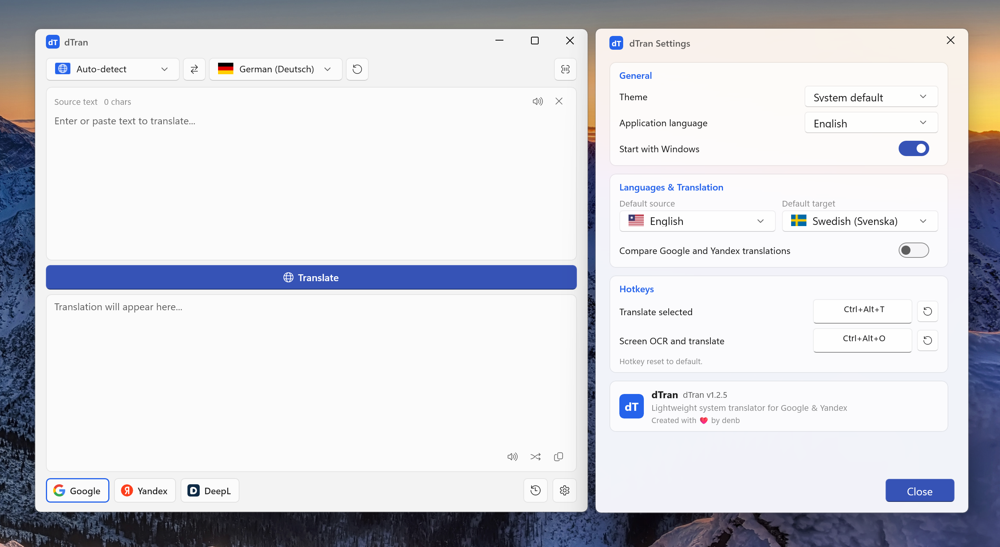

# dTran

> Быстрый и лёгкий всплывающий переводчик для Windows на базе Google Translate, Яндекс Переводчика и DeepL.

[English](README.md) | [Русский](README.ru.md)

[](LICENSE)
[](https://github.com/denbdenb/dTran)
[](https://github.com/denbdenb/dTran/releases)



**dTran** — это нативный переводчик для рабочего стола Windows, работающий в системном трее. Выделите текст в любом приложении, нажмите глобальную комбинацию клавиш — мгновенно откроется всплывающее окно с переводом, а при необходимости исходный текст можно автоматически заменить переводом на месте.

---

## Основные возможности

* **Три движка перевода (Google, Яндекс и DeepL):** Мгновенный перевод через ведущие веб-сервисы с автоматическим определением языка оригинала.
* **Всплывающий интерфейс (Popup-First):** Приложение незаметно находится в системном трее и мгновенно открывается по горячей клавише или клику по иконке.
* **Перевод выделенного (`Ctrl+Alt+T`):** Захват выделенного текста в любом активном окне (браузеры, текстовые редакторы, документы, мессенджеры) через UI Automation и буфер обмена.
* **Замена выделенного текста:** Переводит и сразу вставляет результат вместо исходного текста в активной программе, восстанавливая исходное содержимое буфера обмена.
* **Распознавание с экрана / OCR (`Ctrl+Alt+O`):** Быстрый инструмент выделения области экрана для распознавания текста через нативную библиотеку `Windows.Media.Ocr` с возможностью перевода или копирования.
* **Озвучивание текста (TTS):** Чёткое воспроизведение речи с автоопределением языка и последовательным потоковым воспроизведением длинных фраз.
* **Поддержка длинных текстов:** Интеллектуальное разбиение текста по абзацам и предложениям (`TextChunker`) переводит большие статьи без обрезки и потери структуры.
* **Сравнение переводов:** Возможность сопоставить результаты различных сервисов в одном окне в один клик.
* **История переводов:** Быстрая локальная история с поиском, мгновенным копированием и повторной вставкой текста.
* **10 языков интерфейса:** Полная поддержка 10 мировых языков с переключением в реальном времени.
* **Автозапуск вместе с Windows:** Интеграция с нативным диспетчером автозагрузки Windows (`Windows.ApplicationModel.StartupTask`) с синхронизацией состояния в Диспетчере задач.
* **Современный стиль Windows 11:** Интерфейс на базе WinUI 3 и Fluent Design с поддержкой светлой и тёмной темы и бесшовным меню в трее.
* **Минимальное потребление памяти:** В фоновом режиме в системном трее потребляет всего **~9–15 МБ** оперативной памяти.

---

## Установка

### Рекомендуемый способ (Установщик Setup.exe)
1. Скачайте **[`dTran-1.2.5-x64-Setup.exe`](https://github.com/denbdenb/dTran/releases/latest)** из раздела последних релизов на GitHub.
2. Запустите установщик (устанавливает в стандартную папку `C:\Program Files\dTran` без необходимости включать Режим разработчика).
3. Все необходимые системные компоненты (Windows App SDK Runtime и VCLibs) уже встроены в дистрибутив.
4. Запустите dTran из меню «Пуск», ярлыка на рабочем столе или из трея.
5. Выделите любой текст в любой программе и нажмите `Ctrl+Alt+T` для перевода!

### Портативная версия (Portable Zip)
1. Скачайте архив **[`dTran-1.2.5-x64-Portable.zip`](https://github.com/denbdenb/dTran/releases/latest)**.
2. Распакуйте архив в любую удобную папку и запустите `dTranslate.exe`. Установка не требуется.

### Удаление
* Чтобы удалить приложение, откройте **Параметры Windows** → **Приложения** → **Установленные приложения** → найдите **dTran** → нажмите **Удалить**, либо воспользуйтесь ярлыком деинсталляции в меню «Пуск». Пользовательские настройки и история в `%LOCALAPPDATA%\dTranslate` при этом сохраняются.

---

## Поддерживаемые платформы

* **Windows 11 x64** (все редакции, версия 21H2 и новее)
* **Windows 10 x64** (сборка 19041 и новее)
* *Архитектура:* x64

---

## Горячие клавиши по умолчанию

| Сочетание | Действие |
|---|---|
| **`Ctrl + Alt + T`** | Перевести выделенный текст / Открыть окно dTran |
| **`Ctrl + Alt + O`** | Распознать текст с экрана (OCR) и перевести |
| **`Esc`** | Скрыть всплывающее окно в трей / Отменить выделение области |

> *Примечание: Горячие клавиши можно переназначить или сбросить в окне «Настройки».*

---

## Архитектура

dTran написан на чистом **C++20** с использованием **C++/WinRT** и **WinUI 3**. Приложение не использует Electron, Node.js, среду .NET или компоненты WebView2.

```text
Системный трей
    ↓
Всплывающее окно перевода
    ├── Движок Google Translate
    ├── Движок Яндекс Переводчик
    ├── Движок DeepL Web Translate
    ├── Распознавание Windows Media OCR
    ├── Синтез речи Google TTS
    ├── Буфер истории переводов
    └── Окно настроек
```

---

## Конфиденциальность

* **Прямые запросы к сервисам:** Сетевые запросы на перевод отправляются непосредственно с вашего компьютера на серверы провайдеров через нативный стек WinHTTP по защищенному протоколу HTTPS.
* **Отсутствие промежуточных серверов:** dTran не имеет собственных серверов, баз данных или систем сбора аналитики.
* **Никакой телеметрии:** Приложение не собирает данные пользователя, отчёты об ошибках или логи поведения.
* **Локальное хранение:** Все настройки и история переводов хранятся исключительно на вашем компьютере в каталоге `%LOCALAPPDATA%`.

---

## Сборка из исходного кода

### Необходимые инструменты
* Windows 10/11 x64
* [Visual Studio 2022](https://visualstudio.microsoft.com/) (Community или Build Tools) с компонентами:
  * Разработка классических приложений на C++
  * Набор инструментов MSVC v143 (C++20)
  * Windows 10/11 SDK (10.0.22621.0 или новее)
* [Inno Setup 6](https://www.innosetup.com/) (для компиляции установщика)

### Команды сборки

```powershell
# 1. Клонирование репозитория
git clone https://github.com/denbdenb/dTran.git
cd dTran

# 2. Компиляция Release x64 бинарного файла
powershell -ExecutionPolicy Bypass -File .\build.ps1 -Configuration Release

# 3. Запуск автоматических тестов (189/189 тестов)
powershell -ExecutionPolicy Bypass -File .\scripts\build_test_runner.ps1

# 4. Сборка пакетов дистрибуции (Setup.exe + Portable Zip)
powershell -ExecutionPolicy Bypass -File .\scripts\build_installer.ps1
```

Все готовые файлы будут собраны в папке `dist/`.

---

## Лицензия

Проект распространяется под лицензией [MIT](LICENSE).
Лицензии сторонних библиотек приведены в файле [THIRD-PARTY-NOTICES.md](THIRD-PARTY-NOTICES.md).
